<h1 align="center">DeskPuff</h1>

<p align="center"><strong>Light a virtual cigarette on your Mac desktop.</strong></p>

<p align="center">
  
  
  
  
  
</p>

<p align="center">
  <a href="#features">Features</a> ·
  <a href="#features">Showcase</a> ·
  <a href="#buy-me-a-coffee">Support</a> ·
  <a href="#get-started">Get started</a> ·
  <a href="docs/PLAYER-GUIDE.en.md">Player guide</a> ·
  <a href="README.zh-CN.md">简体中文</a>
</p>

<p align="center"><a href="https://www.bilibili.com/video/BV14gsQ69EM4/">▶ Watch the DeskPuff trailer on Bilibili</a></p>

Open a pack, take out a cigarette, and light it. Watch smoke drift upward, flick off ash, and move objects around your desktop. From the first spark to the final extinguish, every step is yours to perform.

From the way a pack opens to the fade of a plume, DeskPuff pays attention to the small interactions that make desktop objects feel natural and responsive.

> But DeskPuff is more than a smoking simulator.

Collect, recycle, and craft with the ash and cigarette butts left behind. Add items, organize your bag, unlock the collection catalog, and build a record of your progress.

The game lives right on your Mac desktop. Drop in for a moment, or leave it quietly in a corner of your screen.

---

## Features

### 🚬 From pack to ash, every step is yours

Open a pack, take out a cigarette, and light the tip.

Ash builds as the cigarette burns and smoke slowly rises. Take a puff, exhale, flick off ash, place the cigarette in an ashtray, or stub it out.

This isn't a canned animation. Ash falls, the cigarette tip deforms, and objects respond to your actions.

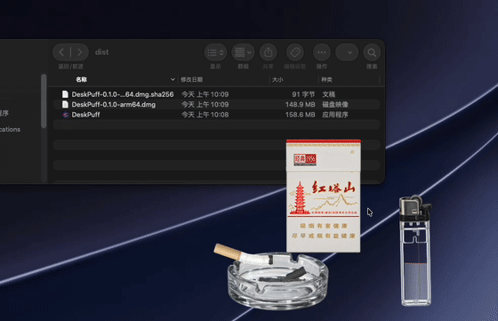

### 🖥️ Your Mac desktop is the game world

DeskPuff doesn't need a separate game world. Cigarettes, lighters, and ashtrays sit right on your real desktop.

Move objects, adjust their angles, and arrange them however you like. Switch to Natural Fall to see gravity pull them toward screen edges and into contact with windows and the Dock.

Play with the objects, or leave them quietly in a corner of your screen.

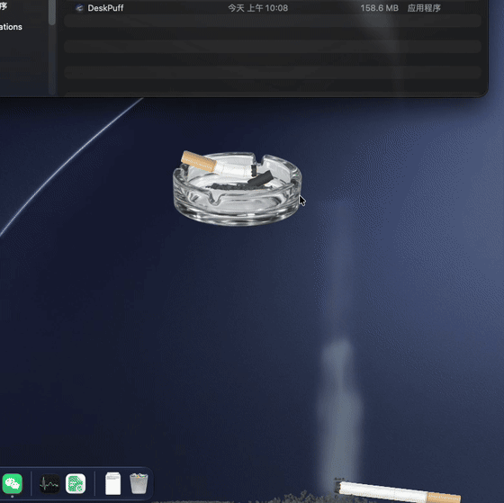

### ♻️ When a cigarette burns out, the game keeps going

Ash and cigarette butts are more than leftovers.

Collect materials with your bag and bring them to the recovery workshop. Try different crafting recipes to discover keepsakes and grow your collection.

Keep what you make, or sell some items for in-game currency. Each interaction can lead to another discovery.

Smoking, collecting, crafting, and discovering add another layer to DeskPuff.

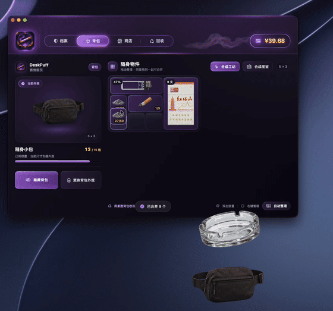

### 🎒 Organize your bag and collect little treasures

As you play, you'll find more materials and items.

Move, rotate, and arrange objects in your grid-based bag, or use auto-organize to make room.

Add cigarettes, lighters, ashtrays, and carry items from the in-game shop, then arrange your desktop your way.

Keep experimenting with crafting recipes and add new discoveries to your collection.

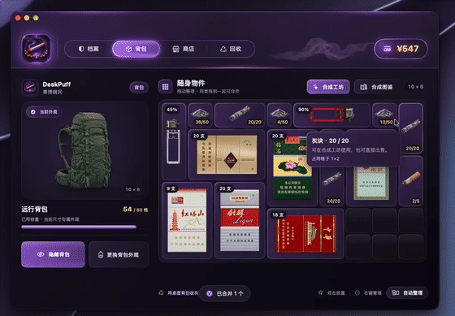

### ☁️ You can simply sit back and watch

You don't always need a goal.

Leave a cigarette on your desktop, watch the smoke drift, and occasionally move an object. That can be the whole experience.

DeskPuff can be a small game with collections and progression, or a quiet interactive toy in the corner of your desktop.

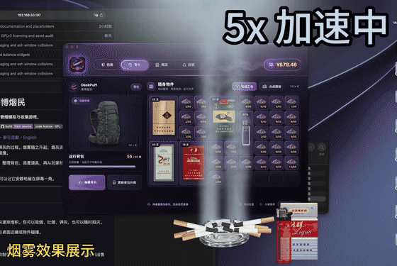

### 🏆 Keep a record of your time in the game

DeskPuff also keeps a player progress record.

As you play, raise your smoker rank and stars, unlock achievements, and follow your collection and play history.

Your profile also records in-game spending, income, and progress, turning small desktop moments into a history of your own.

---

## Game details

### ✨ A desktop scene that feels lived in

The appeal of DeskPuff is not just in what you click; it is in how the desktop remembers what just happened. Open a pack, light a cigarette, watch the ash lengthen and flick away. The objects change with your actions, turning a collection of props into a small scene in progress.

Smoke rises and disperses around the flame. Press a cigarette into the ashtray and its tip keeps the mark of that pressure. Move an object or let it fall, and its collision and landing are visible. Each small interaction gives you a reason to pause and watch a little longer.

Click a thumbnail to view the full-size screenshot.

| A whole desktop scene at a glance | Play is always close at hand | Every discovery joins your collection |
| --- | --- | --- |
| [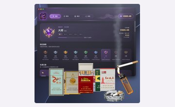](docs/assets/screenshots/mainview.png) | [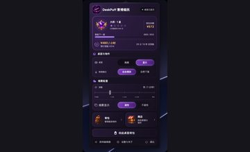](docs/assets/screenshots/card.png) | [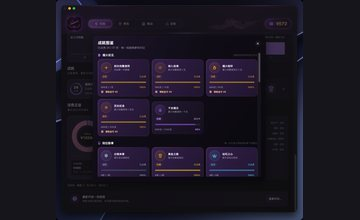](docs/assets/screenshots/collection.png) |
| A play history that becomes your own | Bring the items you like to your desktop | Dev tool: tune and inspect game content |
| [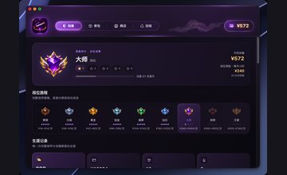](docs/assets/screenshots/profile.png) | [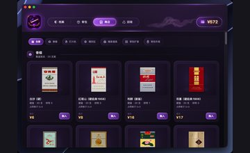](docs/assets/screenshots/shop.png) | [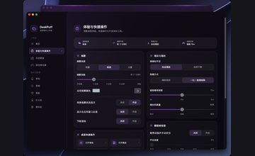](docs/assets/screenshots/gameedit-1.png) |
| Dev tool: shape rank and progression | Dev tool: preview item styles | Familiar packs, your own desktop feel |
| [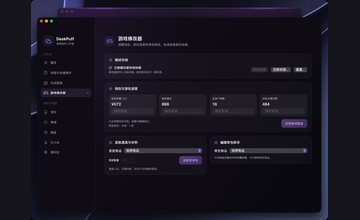](docs/assets/screenshots/gameedit-2.png) | [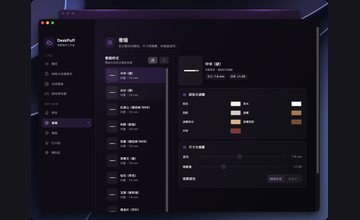](docs/assets/screenshots/gameedit-3.png) | [](docs/assets/screenshots/cigarette-cases.png) |
| The pressed tip keeps its shape | A spark, then smoke |  |
| [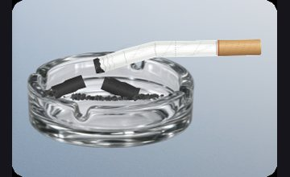](docs/assets/screenshots/ashtray.png) | [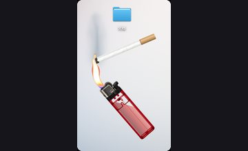](docs/assets/screenshots/lightup.png) |  |

## Buy me a coffee

If you enjoy DeskPuff, you can support its continued development by buying the maintainer a coffee.

| Alipay | WeChat Pay |
| --- | --- |
| [](docs/assets/screenshots/AliPayQR.PNG) | [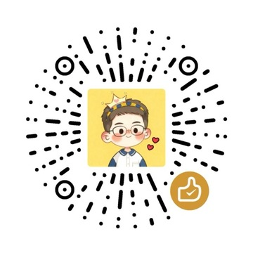](docs/assets/screenshots/wechatQR.JPG) |

### Join the player group

Join the QQ group for the latest test builds and community discussions.

**DeskPuff Cyber Smoker Players · QQ group 207898947**

<a href="docs/assets/screenshots/QQGroupQR-cropped.jpg">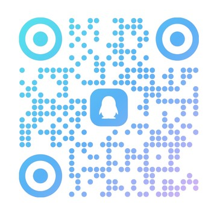</a>

## Get started

DeskPuff supports macOS 14 or later on Apple Silicon. Game progress is saved locally, and no account is required. There is no public installer yet; you can build the app from source.

### Requirements

- macOS 14 or later
- Apple Silicon Mac
- A Swift toolchain compatible with your macOS SDK

From the repository root, run:

```sh
make debug
open dist/DeskPuff.app
```

For your first session, see the [player guide](docs/PLAYER-GUIDE.en.md). Build options and packaging details are in [Build and packaging](docs/BUILD-AND-PACKAGING.md).

### Community release DMG (maintainers)

Build an Apple Silicon release DMG with:

```sh
make dmg 0.1.1
```

The script creates a DMG and SHA-256 file under `dist/`, after asking you to confirm asset rights. The DMG is ad-hoc signed and not notarized, so macOS may show a Gatekeeper prompt on first launch. See the [packaging guide](docs/BUILD-AND-PACKAGING.md) for release checks.

## Open source and community

DeskPuff welcomes development contributions, bug reports, gameplay suggestions, and custom item style packs.

| Resource | What you'll find |
| --- | --- |
| [Player guide](docs/PLAYER-GUIDE.en.md) | Controls and gameplay |
| [Build and packaging](docs/BUILD-AND-PACKAGING.md) | Development setup and build process |
| [Custom style packs](docs/style-packs/README.md) | Create custom item appearances |
| [Contributing](CONTRIBUTING.md) | Get involved in development |
| [简体中文](README.zh-CN.md) | Chinese project page |

## License and assets

Program code the project is entitled to license is available under [GPL-3.0](LICENSE). Game art, media, and official branding have separate terms.
See [asset licensing](ASSET_LICENSE.md) for the rights and attribution status of artwork and media.
