<h1 align="center">DeskPuff · 赛博烟民</h1>

<p align="center"><strong>在你的 Mac 桌面，点燃一支虚拟香烟。</strong></p>

<p align="center">
  
  
  
  
  
</p>

<p align="center">
  <a href="#游戏特色">游戏特色</a> ·
  <a href="#游戏特色">实机展示</a> ·
  <a href="#请我喝杯咖啡">支持项目</a> ·
  <a href="#下载与安装">下载游玩</a> ·
  <a href="docs/PLAYER-GUIDE.md">玩家指南</a> ·
  <a href="README.md">English</a>
</p>

<p align="center"><a href="https://www.bilibili.com/video/BV14gsQ69EM4/">▶ 在 Bilibili 观看 DeskPuff 宣传视频</a></p>

打开烟盒，取出香烟，用打火机点燃。看着烟雾缓缓升起，弹落烟灰，随手移动桌面上的物件——从点火、燃烧到最终熄灭，每一步都可以亲手操作。

从烟盒开合的瞬间，到一缕烟雾的消散，DeskPuff 尝试认真对待每一个微小的互动细节，让桌面上的虚拟物件拥有更自然、更真实的反馈。

> 但这不只是一个抽烟模拟器。

燃烧留下的烟灰与烟头可以收集、回收、合成，发现新的藏品。你还可以添置道具、整理背包、解锁图鉴，逐步积累属于自己的游戏收藏与成长记录。

整个游戏直接融入 Mac 桌面。想玩时随手摆弄几下，也可以让它安静地留在屏幕一角。

---

## 游戏特色

### 🚬 从烟盒到烟灰，每一步都能亲手操作

打开烟盒，抽出一支香烟，拿起打火机点燃烟头。

香烟会在燃烧过程中逐渐积累烟灰，烟雾缓缓升起。你可以吸烟、吐烟、弹灰，也可以把香烟放进烟灰缸，或直接掐灭。

这里不只是播放一段预设动画。烟灰的掉落、烟头的形变、物件的移动，都会随着你的操作产生变化。

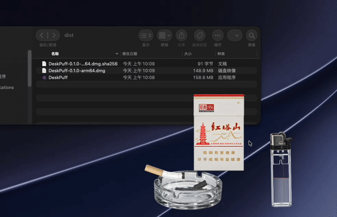

### 🖥️ 你的 Mac 桌面，就是游戏场景

DeskPuff 不需要一个独立的游戏世界。香烟、打火机、烟灰缸就摆在你的真实桌面上。

拖动物件、调整角度，随意组合和摆放。切换自然下落模式，看它们受到重力影响，落向屏幕边缘，与窗口和 Dock 发生互动。

你可以认真摆弄这些物件，也可以让它们安静地待在桌面一角。

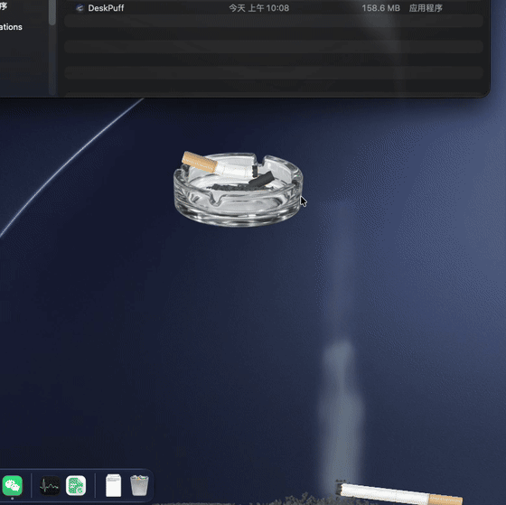

### ♻️ 一支烟燃尽，游戏才刚刚开始

燃烧留下的烟灰和烟头并不只是废弃物。

用背包收集材料，带到回收工坊，尝试不同的合成配方。从普通的燃烧残留物中发现新的藏品，逐渐丰富你的收藏图鉴。

发现的物品可以收藏，部分产物还可以出售换取游戏币，让每一次互动都成为后续探索的一部分。

抽烟、收集、合成、发现，构成 DeskPuff 的另一层玩法。

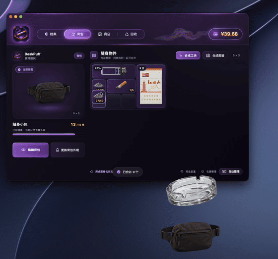

### 🎒 整理背包，收藏自己的小玩意

随着游戏推进，你会接触到越来越多的材料和道具。

在网格背包中移动、旋转和摆放物品，也可以使用自动整理功能，让有限的空间容纳更多东西。

通过游戏商店添置香烟、打火机、烟灰缸与随身道具，再按照自己的喜好布置桌面。

喜欢收集的玩家，还可以继续探索合成配方，把发现的新物品逐步收入图鉴。

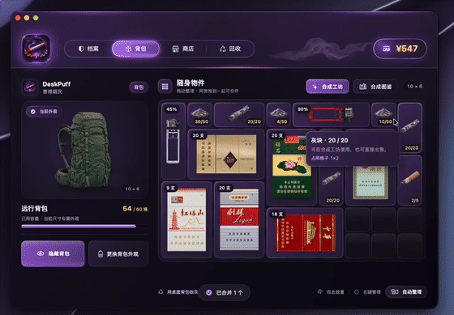

### ☁️ 不用一直玩，也可以只是看着它

有时候，你并不需要完成什么目标。

只是把香烟放在桌面上，看烟雾慢慢飘散，偶尔拨弄一下物件，也是一种玩法。

DeskPuff 可以是一款有收集与成长目标的小游戏，也可以只是桌面角落里一个安静的互动玩具。

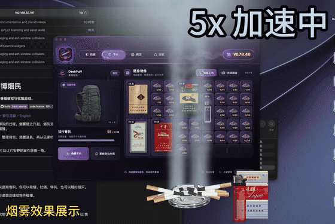

### 🏆 从第一支香烟，留下自己的游戏记录

DeskPuff 还有一套完整的玩家成长档案。

随着游玩积累，你可以逐步提升烟民段位和星级，解锁成就，查看自己的收藏进度与游戏历程。

玩家档案还会记录游戏内的消费、收入及成长数据，让这些零散的桌面互动逐渐留下属于自己的记录。


---

## 游戏细节

### ✨ 让桌面像一张正在使用的烟桌

DeskPuff 的乐趣，不只在于“点了什么”，更在于桌面会留下刚刚发生过的痕迹：烟盒被打开，烟头亮起，烟灰慢慢变长又被弹落。香烟的状态随着你的动作变化，桌面也从摆设变成一段正在发生的小场景。

烟雾从火光旁升起、散开；烟头按进烟灰缸会留下挤压变形；物件移动或落下时，碰撞和落点也看得见。每次随手互动都有细微变化，让人愿意停下来多看一会儿。

| 一眼看见桌面上的完整烟趣 | 想玩时，入口就在菜单栏 | 每次发现，都成为收藏的一部分 |
| --- | --- | --- |
| [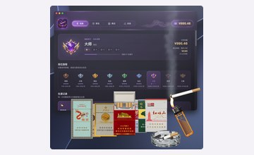](docs/assets/screenshots/mainview.png) | [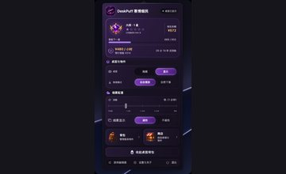](docs/assets/screenshots/card.png) | [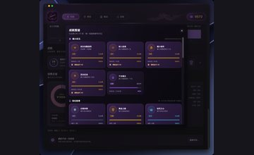](docs/assets/screenshots/collection.png) |
| 成长历程，慢慢变成自己的档案 | 把喜欢的道具添进桌面 | 开发工具：调整与检查游戏内容 |
| [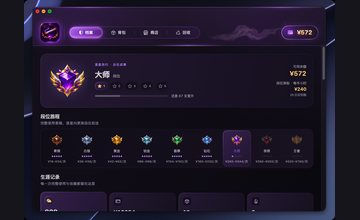](docs/assets/screenshots/profile.png) | [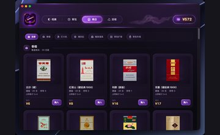](docs/assets/screenshots/shop.png) | [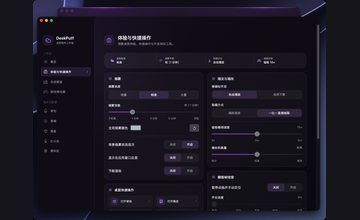](docs/assets/screenshots/gameedit-1.png) |
| 开发工具：打磨段位与成长配置 | 开发工具：预览物品视觉风格 | 熟悉的烟盒，摆出自己的桌面味道 |
| [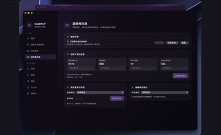](docs/assets/screenshots/gameedit-2.png) | [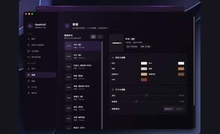](docs/assets/screenshots/gameedit-3.png) | [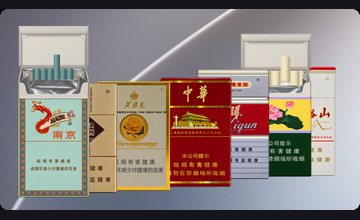](docs/assets/screenshots/cigarette-cases.png) |
| 烟头按下去，形变也留下来 | 火焰点亮烟头，烟雾随之升起 |  |
| [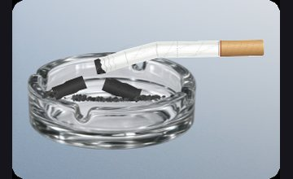](docs/assets/screenshots/ashtray.png) | [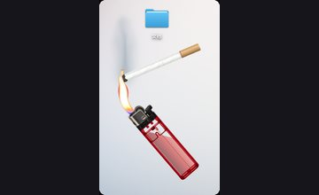](docs/assets/screenshots/lightup.png) |  |

## ☕ 请我喝杯咖啡

如果你喜欢 DeskPuff，可以自愿支持项目的持续开发与维护。所有功能仍然免费开源。

项目会继续免费开源，你的 Star、反馈和代码贡献也同样重要。❤️

| 支付宝 | 微信支付 |
| --- | --- |
| [](docs/assets/screenshots/AliPayQR.PNG) | [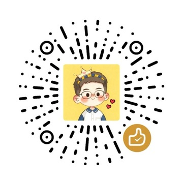](docs/assets/screenshots/wechatQR.JPG) |

### 加入玩家交流群

进群下载最新测试版本，参与 DeskPuff 讨论交流。

**DeskPuff 赛博烟民玩家交流群 · QQ 群号 207898947**

<a href="docs/assets/screenshots/QQGroupQR-cropped.jpg">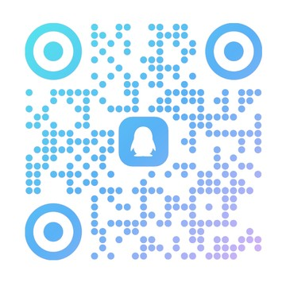</a>

## 下载与安装

**系统要求：macOS 14 或更新版本 · Apple Silicon（arm64）**

[下载 DeskPuff 0.1.0 Mac 版（.dmg）](https://github.com/DreamHeart09/DeskPuff/releases/download/0.1.0/DeskPuff-0.1.0-arm64.dmg) · [SHA-256 校验文件](https://github.com/DreamHeart09/DeskPuff/releases/download/0.1.0/DeskPuff-0.1.0-arm64.dmg.sha256) · [查看全部发布文件](https://github.com/DreamHeart09/DeskPuff/releases/tag/0.1.0)

打开下载的 DMG，将 **DeskPuff.app** 拖到“应用程序”文件夹即可。游戏进度保存在本机，无需注册账号。首次游玩可参考[玩家指南](docs/PLAYER-GUIDE.md)。

应用使用 ad-hoc 签名，未经 Apple 公证，首次启动时 macOS 可能显示安全提示。如果你确认文件来自本项目 Release 页面，可在 Finder 中按住 Control 单击应用，选择“打开”并确认。更多说明见[构建与打包](docs/BUILD-AND-PACKAGING.md)。

### 从源码构建（开发者）

安装与本机 macOS SDK 匹配的 Swift 开发工具链后，在项目根目录运行：

```sh
make debug
open dist/DeskPuff.app
```

构建选项和打包说明见[构建与打包](docs/BUILD-AND-PACKAGING.md)。

## 开源与社区

DeskPuff 欢迎开发贡献、问题反馈、玩法建议和自定义物品样式包。

| 资源 | 内容 |
| --- | --- |
| [玩家指南](docs/PLAYER-GUIDE.md) | 操作与玩法说明 |
| [构建与打包](docs/BUILD-AND-PACKAGING.md) | 开发环境与构建流程 |
| [自定义样式包](docs/style-packs/README.md) | 创建自定义物品外观 |
| [贡献指南](CONTRIBUTING.md) | 参与项目开发 |
| [English](README.md) | 英文项目首页 |

## 许可证与素材

项目中有权许可的程序代码采用 [GPL-3.0](LICENSE)。游戏美术、媒体素材及官方品牌标识适用独立授权条款；
详见英文版[素材与许可说明](ASSET_LICENSE.md)。
